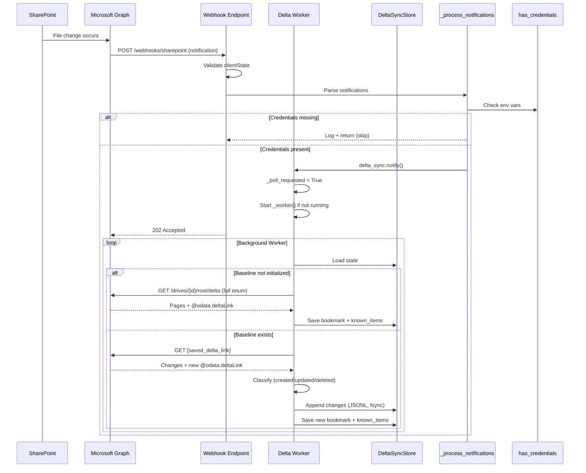

# SharePoint Integration Architecture

## Overview

This document describes the architecture of the SharePoint Integration service, focusing on:
1. **Microsoft Graph Delta API** — Change detection and synchronization
2. **Webhook Endpoint** — Real-time change notifications from SharePoint
3. **Background Delta Sync Worker** — Coalesced, resilient polling

The service provides two separate SharePoint integrations:
- **Read Path** (`service.py`) — Discovers and downloads files from a source site/library
- **Write Path** (`upload.py`) — Uploads artifacts to a separate output site/library
- **Delta Sync** (`delta_sync.py`) — Detects changes via Graph Delta API

---

## High-Level Data Flow

```mermaid
flowchart TD
    subgraph SharePoint
        SP[SharePoint Document Library]
    end

    subgraph "Microsoft Graph"
        DeltaAPI[Delta API /drives/{id}/root/delta]
        WebhookSub[Subscription /subscriptions]
    end

    subgraph "Integration Service"
        Webhook[Webhook Endpoint<br/>POST /webhooks/sharepoint]
        Worker[Background Delta Worker]
        Store[DeltaSyncStore<br/>.delta_sync_state.json]
        Service[SharePointService<br/>Graph Auth + HTTP]
    end

    SP -->|Changes| WebhookSub
    WebhookSub -->|POST notification| Webhook
    Webhook -->|notify()| Worker
    Worker -->|Poll Delta API| DeltaAPI
    DeltaAPI -->|Changes| Worker
    Worker -->|Classify + Persist| Store
    Worker -.->|Uses| Service
```

---

## Component Architecture

### 1. Webhook Endpoint (`main.py`)

**Route:** `POST /webhooks/sharehook`

**Responsibilities:**
- Validation token handshake (Microsoft Graph subscription verification)
- Client state validation (optional HMAC-like shared secret)
- Notification parsing and validation
- Delegating to `_process_notifications()`

**Key Code Path:**
```python
# main.py:73-148
@app.post("/webhooks/sharepoint")
async def sharepoint_webhook(request: Request):
    # 1. Validation token handshake
    validation_token = request.query_params.get("validationToken")
    if validation_token:
        return PlainTextResponse(content=validation_token, ...)

    # 2. Parse notification payload
    payload = NotificationPayload(**await request.json())

    # 3. Validate clientState (if configured)
    if expected_client_state:
        for n in payload.value:
            if not constant_time_compare(n.clientState, expected_client_state):
                raise HTTPException(401, "Invalid clientState")

    # 4. Process notifications (non-blocking)
    await _process_notifications(payload.value)
    return JSONResponse({"status": "accepted"}, 202)
```

**Notification Processing (`main.py:161-209`):**
```python
async def _process_notifications(notifications: List[NotificationItem]):
    # Log notification summary (change types, lifecycle events)
    ...

    # CREDENTIAL CHECK — blocks delta sync if missing
    if not has_credentials():
        logger.info("SharePoint credentials not configured; skipping delta sync")
        return

    # Trigger background delta poll
    delta_sync = _get_delta_sync()
    delta_sync.notify()  # Sets poll_requested flag, starts worker if needed
```

---

### 2. Delta Sync Core (`delta_sync.py`)

#### 2.1 SharePointDeltaSync Class

**Singleton Pattern** — App-wide instance via `get_delta_sync()` (line 777)

**Key State:**
| Field | Purpose |
|-------|---------|
| `_sync_lock` | `asyncio.Lock` — prevents concurrent sync operations |
| `_poll_requested` | Boolean flag — set by `notify()`, cleared before each poll |
| `_worker_task` | `asyncio.Task` — background worker coroutine |
| `_last_result` | Latest `DeltaSyncResult` for inspection |

**Public API:**
| Method | Description |
|--------|-------------|
| `initialize_baseline()` | Full enumeration, saves initial `@odata.deltaLink` |
| `sync_once(since, until)` | Single poll using stored delta link |
| `notify()` | Signal from webhook — schedules background poll |
| `status()` | Inspect bookmark, known items, worker health |
| `get_last_changes()` | Classified changes from last run |

#### 2.2 Synchronization Phases

**Phase 1: Baseline (One-time)**
```
GET /drives/{drive_id}/root/delta
  → Follow all @odata.nextLink pages
  → Record every item ID in known_items (NO changes reported)
  → Save final @odata.deltaLink as bookmark
  → Mark baseline_initialized = true
```

**Phase 2: Poll (Recurring)**
```
GET {saved_delta_link}
  → Follow all @odata.nextLink pages
  → Classify each item:
      - deleted facet      → DELETED
      - ID in known_items  → UPDATED
      - ID not in known    → CREATED
  → Persist ALL changes to JSONL log (append_changes)
  → Advance bookmark to new @odata.deltaLink
  → Save state atomically
```

**Phase 3: Re-baseline (Recovery)**
- Triggered on HTTP 410/400/404 with delta token error codes
- Full re-enumeration from fresh delta link
- Reports DELETED for previously known items now missing
- Does NOT report existing files as CREATED

#### 2.3 Background Worker (`_worker()`)

```python
async def _worker(self):
    failures = 0
    while True:
        state = self._store.load()
        
        # Auto-initialize baseline if needed
        if not state.baseline_initialized:
            await self.initialize_baseline()
            failures = 0
            continue

        # Wait for poll request
        if not self._poll_requested:
            break  # Exit worker; next notify() restarts it

        # Consume poll request
        self._poll_requested = False
        
        try:
            await self.sync_once()
            failures = 0
        except Exception as e:
            failures += 1
            if failures >= self._max_worker_retries:
                logger.error("Worker stopping after %d failures", failures)
                break
            # Re-arm poll request for retry
            self._poll_requested = True
            await asyncio.sleep(self._worker_backoff_base ** min(failures, 5))
```

**Coalescing Guarantees:**
- Multiple `notify()` calls while worker runs → single poll
- Notification during active sync → `_poll_requested` stays `True` → follow-up poll
- Worker exits when idle → next `notify()` spawns new worker

---

### 3. Durable State Storage (`DeltaSyncStore`)

**Files:**
- **State file** — `SHAREPOINT_DELTA_STATE_FILE` (default: `.delta_sync_state.json`)
- **Change log** — `{state_file}.changes.jsonl` (JSON Lines)

**State Schema (`DeltaSyncState`):**
```json
{
  "version": 1,
  "delta_link": "https://graph.microsoft.com/v1.0/drives/.../root/delta?$deltatoken=...",
  "known_items": {
    "item-id-1": { "id": "...", "name": "...", "path": "...", "size_bytes": 123, ... },
    "item-id-2": { ... }
  },
  "baseline_initialized": true,
  "last_sync_started_at": "2026-10-13T11:00:00Z",
  "last_sync_completed_at": "2026-10-13T11:00:05Z",
  "last_change_counts": { "created": 2, "updated": 1, "deleted": 0 },
  "total_changes_seen": 150
}
```

**Atomic Write Protocol:**
1. Write to `{state_file}.tmp`
2. `os.replace(tmp, state_file)` — atomic on POSIX, near-atomic on Windows
3. Change log flushed + `fsync()` before bookmark advance

---

### 4. SharePointService (`service.py`)

**Role:** Shared Graph authentication + retrying HTTP client for both Delta Sync and file operations.

**Key Features:**
- **OAuth2 Client Credentials Flow** — `https://login.microsoftonline.com/{tenant}/oauth2/v2.0/token`
- **Token Caching** — In-memory, refreshed on 401
- **Retry Strategy** — Exponential backoff, status_forcelist=[429,500,502,503,504]
- **Connection Pooling** — `pool_connections=20`, `pool_maxsize=50`
- **SSL Config** — `SHAREPOINT_SSL_VERIFY` (default true)

**Initialization:**
```python
# service.py:19-21
from dotenv import load_dotenv
load_dotenv(Path(__file__).resolve().parents[1] / ".env")

# service.py:53-74
def __init__(self):
    self.tenant_id = os.getenv("SHAREPOINT_TENANT_ID")
    self.client_id = os.getenv("SHAREPOINT_CLIENT_ID")
    self.client_secret = os.getenv("SHAREPOINT_CLIENT_SECRET")
    # ... site/library config
    self.session = self._create_session()
```

**Note:** `.env` loads at **import time** of `sharepoint_integration.service`.

---

### 5. Router Endpoints (`router.py`)

| Endpoint | Method | Purpose |
|----------|--------|---------|
| `/sharepoint/health` | GET | Liveness check |
| `/sharepoint/files` | GET | List all files (tagged by folder) |
| `/sharepoint/files/count` | GET | File counts by tag |
| `/sharepoint/files/{path}` | GET | Get file metadata by relative path |
| `/sharepoint/delta/status` | GET | Inspect delta sync state |
| `/sharepoint/delta/initialize` | POST | Trigger baseline manually |
| `/sharepoint/delta/sync` | POST | Manual delta poll (with since/until filter) |

All endpoints lazily initialize `SharePointService` and `SharePointDeltaSync` on first request.

---

## Configuration

### Required Environment Variables

| Variable | Purpose | Example |
|----------|---------|---------|
| `SHAREPOINT_TENANT_ID` | Azure AD tenant 
| `SHAREPOINT_CLIENT_ID` | App registration client ID 
| `SHAREPOINT_CLIENT_SECRET` | App registration secret 

### Read Site (Source)

| Variable | Purpose | Default |
|----------|---------|---------|
| `SHAREPOINT_DOMAIN` | SharePoint tenant domain | — |
| `SHAREPOINT_SITE_PATH` | Site relative path | `/` |
| `SHAREPOINT_LIBRARY_NAME` | Document library name | `Documents` |
| `SHAREPOINT_BASE_FOLDER` | Folder under library | `` (root) |

### Write Site (Output)

| Variable | Purpose |
|----------|---------|
| `SHAREPOINT_OUTPUT_DOMAIN` | Output site domain |
| `SHAREPOINT_OUTPUT_SITE_PATH` | Output site path (e.g., `/sites/SmartRFP-Outputs`) |
| `SHAREPOINT_OUTPUT_LIBRARY` | Output library name |

### Webhook

| Variable | Purpose |
|----------|---------|
| `SHAREPOINT_WEBHOOK_CLIENT_STATE` | Shared secret for notification validation |

### Delta Sync

| Variable | Purpose | Default |
|----------|---------|---------|
| `SHAREPOINT_DELTA_STATE_FILE` | State file path | `.delta_sync_state.json` |

### Optional Tuning

| Variable | Default |
|----------|---------|
| `SHAREPOINT_SSL_VERIFY` | `true` |
| `SHAREPOINT_CONNECT_TIMEOUT` | `30` |
| `SHAREPOINT_READ_TIMEOUT` | `120` |
| `SHAREPOINT_MAX_RETRIES` | `5` |
| `SHAREPOINT_POOL_CONNECTIONS` | `20` |
| `SHAREPOINT_POOL_MAXSIZE` | `50` |

---

## Error Handling & Resilience

### Delta Link Expiry
- **Detected:** HTTP 410, or 400/404 with error codes `deltalinkexpired`, `invaliddeltatoken`, `itemnotfound`
- **Recovery:** Automatic re-baseline (safe — existing files not reported as new)
- **Trigger:** `DeltaLinkExpiredError` caught in `sync_once()`

### Network Resilience
- **Retries:** 3 attempts with exponential backoff (base 2s) in `SharePointService`
- **Delta Worker Retries:** 3 attempts with backoff (base 2s) in `_worker()`
- **Token Refresh:** Automatic on 401 — clears cache, re-acquires token

### Atomic State Persistence
- State file written to temp + atomic rename
- Change log flushed + `fsync()` before bookmark advance
- Crash during sync → re-reads previous valid bookmark

---

## Sequence Diagram: Webhook → Delta Poll



---

## Deployment Considerations

### Webhook Subscription
Create subscription via Graph API:
```bash
POST https://graph.microsoft.com/v1.0/subscriptions
{
  "changeType": "updated,deleted",
  "notificationUrl": "https://your-api.example.com/webhooks/sharepoint",
  "resource": "/sites/{site-id}/drives/{drive-id}/root",
  "expirationDateTime": "2026-10-20T11:00:00Z",
  "clientState": "your-shared-secret"
}
```

**Renewal:** Subscriptions expire (max ~3 days for SharePoint). Implement renewal job.

### Process Model
- **Single process** — Worker runs in same event loop as FastAPI
- **Multi-worker (gunicorn/uvicorn --workers)** — Each worker has independent delta state
  - **Solution:** Use external state store (Redis, database) or single-worker deployment
  - **Current:** File-based state — not suitable for multi-worker without shared filesystem

### Monitoring
- **Health:** `GET /sharepoint/health`
- **Delta Status:** `GET /sharepoint/delta/status` → shows `baseline_initialized`, `known_item_count`, `worker_running`, `last_change_counts`
- **Logs:** Structured logging with `delta change:` entries for each classified item

---

## Known Limitations

1. **Single-process state** — File-based `DeltaSyncStore` doesn't support horizontal scaling
2. **No webhook deduplication** — Relies on Graph's clientState; duplicate notifications coalesced in worker
3. **Delta API time window filtering** — `since`/`until` filters applied post-poll; checkpoint-based API doesn't guarantee complete history
4. **Baseline blocks writes** — First run enumerates entire library (can take minutes for large libraries)
5. **No deletion propagation to output site** — Delta sync detects deletions but `upload.py` doesn't act on them

---

## File Reference

| File | Responsibility |
|------|----------------|
| `main.py` | FastAPI app, webhook endpoint, notification processing |
| `router.py` | REST endpoints for file ops + delta sync control |
| `sharepoint_integration/config.py` | Credential check (`has_credentials`), env var definitions |
| `sharepoint_integration/service.py` | Graph auth, HTTP client, file discovery/download |
| `sharepoint_integration/upload.py` | Artifact upload to output site |
| `sharepoint_integration/delta_sync.py` | Delta API sync engine, state store, background worker |
| `sharepoint_integration/paths.py` | Path normalization utilities |

---

## Related Documentation

- [DELTA_SYNC.md](DELTA_SYNC.md) — Detailed delta sync usage guide
- [WEBHOOK_SUMMARY.md](WEBHOOK_SUMMARY.md) — Webhook setup and validation
- [REQ_RES_CYCLE.md](REQ_RES_CYCLE.md) — Request/response cycle documentation